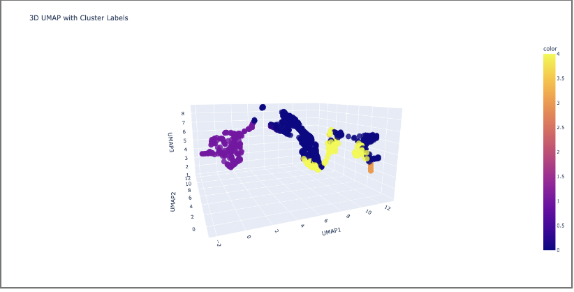

# Exoplanet Habitability Clustering

**Exploring exoplanet similarity with clustering and dimensionality reduction.**

This research project groups exoplanets using seven stellar and orbital properties, then visualizes those groups in a three-dimensional UMAP embedding. Earth is inserted as a reference point for comparison. The analysis is exploratory: membership in the same cluster does not establish that a planet is habitable.



*A saved visualization included in this repository. The axes are embedding coordinates, not physical positions in space.*

## Analysis pipeline

1. Read a NASA-style exoplanet catalog and exclude observations with a controversial flag.
2. Append an Earth reference row and remove records missing the selected features.
3. Standardize the feature values with `StandardScaler`.
4. Fit K-Means with five clusters and `random_state=42`.
5. Project the standardized data into three dimensions using UMAP.
6. Export cluster coordinates and show an interactive Plotly scatter plot.

The features are stellar luminosity, radius, and effective temperature; orbital period, semi-major axis, and eccentricity; and planetary mass. The script also prints the available records for a list of previously studied planets.

## Source and saved results

| File | Purpose |
| --- | --- |
| `UnsupervisedLearningExoplanetDetection.py` | Preprocessing, clustering, projection, and visualization. |
| `cluster_plot.png`, `Plot_April.png`, `Plot_July.png` | Saved plots. |
| `Cluster_Data*.csv` | Saved embedding/cluster tables. |
| `PSCompPars_2023.06.30_20.48.00_dedupe.csv`, `Dedupe.csv` | Bundled catalog data. |
| `habitable-planets.csv` | Reference planet list. |

## Reproduce the analysis

```bash
git clone https://github.com/sudhanvad18/HabitableExoplanets.git
cd HabitableExoplanets
```

The entry point is **`UnsupervisedLearningExoplanetDetection.py`**. Before running it, reconcile these legacy assumptions with your environment:

- The loader currently opens `July_Dataset.csv` and skips 294 preamble rows. That exact filename is absent from the repository. Select the appropriate bundled catalog or supply the intended export, and match its actual CSV header layout.
- The Earth-row insertion uses `DataFrame.append`, which requires an older pandas API or a change to `pandas.concat` for modern pandas.
- Imports require pandas, scikit-learn, Plotly, and UMAP. The `umap.plot` import additionally needs UMAP's plotting dependencies.

Once the input and compatibility issues are resolved:

```bash
python UnsupervisedLearningExoplanetDetection.py
```

The script prints cluster statistics, writes **`Cluster_Data.csv`**, and opens the interactive figure. It overwrites that output table. There is no automated test suite or pinned environment in this snapshot.

## Interpretation

Results depend on the selected properties, missing-data filtering, reference values, scaling, cluster count, and UMAP settings. K-Means uses a fixed seed; the UMAP constructor currently does not. The project does not report a validated habitability classifier or predictive accuracy.

## Acknowledgments

The project was conducted under Professor Downing's guidance. The original work credits NASA's Exoplanet Archive and Gaia for exoplanet data; the included script operates on a prepared catalog rather than implementing a live data-ingestion service.
